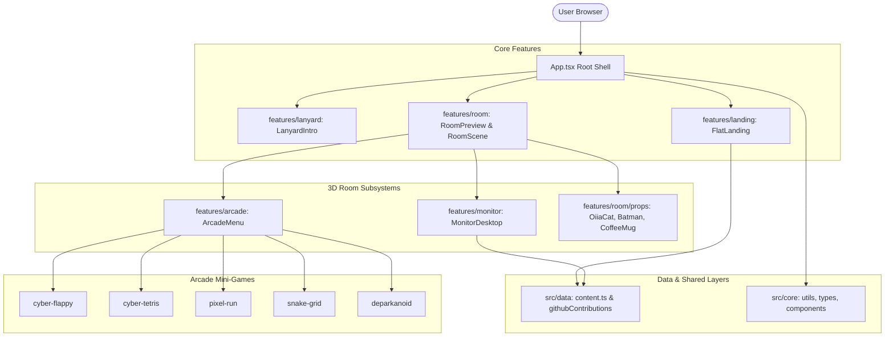
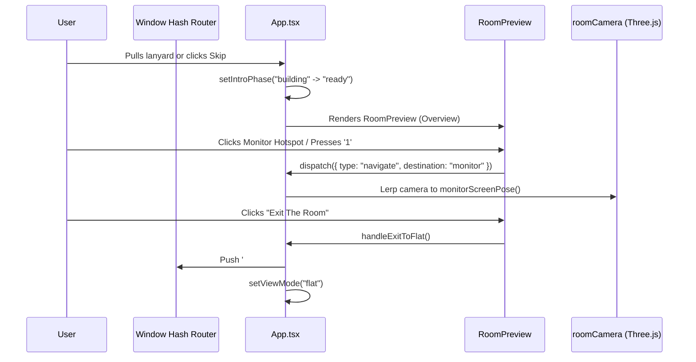

# System Architecture

## 1. System Overview

Amirreza Gholipour's portfolio is architected as a high-performance, single-page application (SPA) built with **React 19**, **TypeScript**, **Vite**, **Three.js**, and **React Three Fiber**.

The application eliminates backend runtime overhead by relying entirely on client-side rendering, deterministic state machines, local browser caching, and bundled offline fallbacks.



---

## 2. Directory & Module Boundaries

The codebase follows a strictly decoupled **Feature-Driven Architecture** with barrel export contracts:

```text
src/
├── app/                  # Application root entry (App.tsx, main.tsx, style.css)
├── core/                 # Shared foundation layer
│   ├── types/            # Canonical coordinate contracts (Point, Dimensions, ViewportSize)
│   ├── utils/            # Shared pure utilities (assetUrl, webglUtils, cn)
│   └── components/       # Cross-cutting UI primitives (exit bar, cursor, arc tabs, kokonutui)
│
├── data/                 # Static content and data fetchers
│   ├── content.ts        # Authoritative resume, projects, and career history
│   ├── githubContributions.ts # GitHub API client with 4-hour caching
│   ├── githubContributionsFallback.json # Bundled offline fallback
│   └── githubRepoPreview.ts # In-window GitHub repository viewer (srcDoc generator, API client & offline fallbacks)
│
└── features/             # Domain-specific feature modules
    ├── arcade/           # Retro CRT cabinet and 5 Canvas mini-games
    ├── monitor/          # 3D projected virtual OS desktop and apps
    ├── room/             # Three.js 3D scene, camera interpolation, lighting, and audio
    ├── lanyard/          # 3D holographic badge, drag physics, and intro phase
    └── landing/          # 2D flat landing page, liquid grid canvas, and GitHub city
```

### Module Encapsulation Rules
- **No Circular Imports:** Modules in `features/` may consume `core/` and `data/`, but never cross-import internal implementation details of sibling features directly. Inter-feature communication flows through top-level props or domain index barrels.
- **Test Colocation:** Unit and component tests (`*.test.ts`, `*.test.tsx`) alongside modular styles (`*.module.css`) reside immediately adjacent to their target source files.

---

## 3. Data Flow & State Management

The architecture deliberately avoids heavy global state libraries (Redux, Zustand, MobX) in favor of predictable, localized React patterns:



1. **Room Navigation Reducer:** A finite state machine managing current focus (`overview`, `monitor`, `arcade`) with history tracking for `Escape` key return.
2. **Hash-Based View Switcher:** Syncs view modes between 3D Room (`#room` or root) and Flat Portfolio (`#portfolio`), enabling deep linking and browser history navigation (Back/Forward).
3. **Data Caching Pipeline:** GitHub commit stats query the public REST API, store the result in `localStorage` with a 4-hour TTL, and gracefully fall back to `githubContributionsFallback.json` upon failure.
4. **Responsive Device & 3D Execution Gate (`src/core/utils/responsive.ts`):** A centralized `useResponsiveDevice` hook evaluates media queries via React 19 `useSyncExternalStore`. On touch devices or viewports $< 1024\text{px}$, `<RoomPreview>` is strictly omitted from the component tree, ensuring zero background WebGL GPU consumption and directing mobile users immediately to `FlatLanding`.
5. **Refractive Optical Liquid Glass Navbar & GPU Compositing Pipeline (`src/features/landing`):** The scrolled sticky navbar integrates Glisse's `<Glass>` component using Glisse's authentic dual-engine architecture. In Chromium/Android, Glisse applies real-time light refraction and chromatic dispersion via `backdrop-filter: blur(3px) url(#glisse-backdrop)`. In Safari/iOS (WebKit), it employs hardware-accelerated `-webkit-backdrop-filter: blur(var(--lg-blur, 3px)) saturate(180%)` paired with Glisse's canvas-rendered chromatic lit rim (`--lg-rim`) and specular highlights. The scrolling page DOM sections remain clean and decoupled from `data-glisse-backdrop`, completely preventing WebKit software filter buffer exhaustion ($4096\text{px}$ tile limit) and eliminating asynchronous touch-scroll compositor drift. Foreground controls reside at `position: relative; z-index: 1` over `.ldNavGlass` (`z-index: 0`).
6. **Scroll-Invariant Arc UI Tab Indicator (`src/core/components/arc/tabs.tsx`):** A single persistent indicator element inside `TabsPrimitive.List` derives its geometry dynamically from `target.offsetLeft` and `target.offsetWidth`, rendering transitions scroll-invariant during simultaneous horizontal swipe gestures on mobile viewports. Local stacking isolation (`isolation: isolate` and `translateZ(0)`) prevents WebKit 3D layer promotion from occluding active tab labels on iOS Safari.
7. **In-Window GitHub Repository Viewer Pipeline (`src/data/githubRepoPreview.ts` & `src/features/monitor/apps/ProjectApp.tsx`):** Standard GitHub repository URLs enforce `X-Frame-Options: deny` and `Content-Security-Policy: frame-ancestors 'none'`, prohibiting raw iframe loading. `ProjectApp` circumvents this restriction cleanly by rendering a high-fidelity, sandboxed `srcDoc` document matching GitHub dark aesthetics. The pipeline renders the repository files tree, one-click `git clone` command copying, and Markdown-parsed `README.md` without requiring users to jump to an external tab. Asynchronous non-blocking GitHub API requests update branch names and file trees in real-time, backed by a 4-hour `localStorage` cache and pre-bundled snapshots for all 6 projects.
8. **Spatial Calibration Wireframe Loader & Roller-Shutter Room-Exit Pipeline (`src/features/landing` & `src/core/components/exit`):** Unveiling the flat landing utilizes a two-phase cinematic pipeline: first, an upward black roller-shutter curtain (`ExitBar`) with custom `cubic-bezier(0.77, 0, 0.175, 1)` easing smoothly blankets the 100svh 3D room. Upon landing mount, `PortfolioLoader` scans live DOM elements and renders an obsidian spatial calibration surface (`#07080d`) with an active downward horizontal laser scanner beam (`.plScanBeam`). Elements materialize via a blended spatial-sequential activation algorithm (`isBlueprintBoxActive`) with 1.5px cyan L-bracket corner reticles, live dimension badges, and bespoke AI telemetry labels (`VIEWPORT // ASCII_CORE`, `IDENTITY // H1`, `ROLE // STREAM`, `NODE // 01..N`). At $86\%$ progress, live DOM typography sharpens from `blur(3px)` into crisp focus, concluding at $100\%$ with a cyan-white spectral edge wipe (`.plEdge`) that unveils the fully interactive landing page.

---

## 4. 3D Graphics & Homography Projection Engine

A critical technical innovation of this portfolio is projecting interactive 2D HTML/DOM applications directly onto 3D surfaces in the WebGL scene without rendering them to slow 2D canvas textures:

### Direct Linear Transformation (DLT) Homography
1. **Corner Extraction:** Three.js computes the 4 world-space corners of the target 3D quad (`MonitorScreen` or `ArcadeScreen`).
2. **Camera Projection:** Corners are projected into Normalized Device Coordinates (NDC) via `Vector3.project(camera)` and mapped to viewport pixels:
   $$\begin{pmatrix} x_{\text{pixel}} \\ y_{\text{pixel}} \end{pmatrix} = \begin{pmatrix} \frac{x_{\text{ndc}} + 1}{2} \cdot W \\ \frac{1 - y_{\text{ndc}}}{2} \cdot H \end{pmatrix}$$
3. **Homography Matrix Calculation:** An 8-DOF Direct Linear Transformation calculates the perspective projective mapping from rectangular source coordinates to the projected quad.
4. **CSS 3D Transform:** The computed matrix is applied as a CSS `matrix3d(...)` transformation directly to the HTML container, providing native DOM text selection, interactive buttons, scrolling, and input fields inside the 3D scene.

---

## 5. Mini-Game Engines Architecture (`features/arcade/games/`)

Each mini-game operates as an autonomous, self-contained engine:
- **Game Loop:** Powered by `requestAnimationFrame` with delta-time ($\Delta t$) normalization to ensure identical physics at 60Hz, 120Hz, or 144Hz.
- **Decoupled Audio Synthesizer:** Mini-games instantiate isolated Web Audio API graphs (`flappyAudio.ts`, `tetrisAudio.ts`, `pixelRunAudio.ts`) creating retro bleeps, jump sweeps, and collision impacts synthetically without external audio asset downloads.
- **State Cleanliness:** Exiting a game cancels the animation frame ID, disconnects audio oscillators, and resets game state cleanly.

---

## 6. Technology Stack & Dependencies

| Layer | Technology | Version | Purpose |
| :--- | :--- | :--- | :--- |
| **Framework** | React / React DOM | 19.3.1 | Core component architecture |
| **Language** | TypeScript | 6.0.3 | Strict type safety and build-time contracts |
| **Bundler** | Vite / Rolldown | 8.3.4 | Ultra-fast HMR and production tree-shaking |
| **3D Engine** | Three.js | 0.186.1 | WebGL2 scene graph, camera, and lighting |
| **3D React** | React Three Fiber | 9.8.2 | Declarative Three.js component bindings |
| **Motion** | Motion (Framer) | 14.10.1 | Spring physics and kinetic transitions |
| **Optics** | tactile-glass-ui | 0.1.1 | WebGL2 refractive glass buttons |
| **Liquid Glass** | glisse | 0.5.0 | Optical refractive liquid glass navbar & hero CTA |
| **Testing** | Vitest | 5.0.5 | 45 unit test suites (254 tests) |
| **E2E Testing**| Playwright | 1.64.1 | Cross-browser Chromium end-to-end verification |
