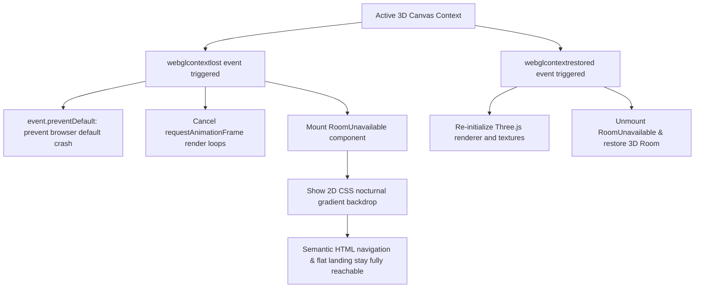

# Error Handling & Resilience Strategy

## 1. Resilience Philosophy

The portfolio follows a strict **Fail-Open & Graceful Degradation** philosophy:
> *No hardware limitation, network outage, or third-party failure should ever produce an unhandled exception, a blank screen, or block access to the candidate's core credentials.*

---

## 2. WebGL Context Loss & GPU Deprivation

WebGL applications can lose their rendering context when system GPU resources are exhausted, devices sleep, or drivers reset.



### Fallback Implementation (`src/features/room/components/RoomUnavailable.tsx`)
When WebGL is unavailable or the context cannot be restored:
- A clean, accessible fallback component is displayed informing the user of the hardware state.
- An instant button to switch directly to the **Flat Landing Portfolio** is presented.
- The CSS nocturnal wallpaper remains visible so the visual aesthetic is preserved.

### Proactive GPU Deprivation Bypass on Mobile & Touch Devices
Rather than relying on reactive context recovery after a mobile device experiences thermal throttling or Out-Of-Memory (OOM) browser crashes, the application proactively assesses device capabilities via `useResponsiveDevice`:
- On any touch-first device (`pointer: coarse`, including iPads) or screen $< 1024\text{px}$, `<RoomPreview>` is strictly not rendered in the DOM (`null`).
- This completely prevents WebGL context allocation, halts all requestAnimationFrame loops, and redirects the user directly into `FlatLanding`.

---

## 3. Sandboxed Iframe & Third-Party Embed Blocking

The Arcade cabinet includes an option to load a PS1 emulator game via an external provider (PS1FUN).

### Failure Modes & Protections
1. **`X-Frame-Options` / `frame-ancestors` Header Rejections:** Many third-party sites disallow iframe embedding.
2. **Network Timeouts & Mixed-Content Blocks:** If an embedded game fails to complete loading within **8 seconds**:
   - An accessible alert (`role="status"`) replaces the unresponsive frame.
   - A direct external link opens the destination cleanly in a new browser tab.
   - The **"Exit Game"** button resides permanently *outside* the iframe DOM, ensuring keyboard and mouse users are never trapped inside an unresponsive embed.

---

## 4. Web Audio Autoplay & Gesture Unlocking

Modern browsers (Chrome, Safari, Firefox) prohibit web applications from generating audio prior to an explicit user interaction.

### Handling Strategy (`src/features/room/audio/oiiaAudio.ts` & Arcade Synthesizers)
- All audio graphs remain completely dormant during initial page load.
- Clicking the Oiia Cat or starting an arcade game triggers `audioContext.resume()` within the verified user event loop.
- If audio initialization is denied or throws a permission error (e.g. strict enterprise policies), the error is caught silently; animations and gameplay proceed smoothly without audio.

---

## 5. Viewport Resize & Window Boundary Clamping

In the virtual monitor desktop, resizing the browser window could cause floating windows to get pushed off-screen.

### Clamping Strategy (`src/features/monitor/utils/desktopDrag.ts`)
- Window coordinates ($x, y$) and dimensions ($w, h$) are continuously bounded:
  $$x_{\text{clamped}} = \max\left(0, \min(x, W_{\text{desktop}} - w)\right)$$
  $$y_{\text{clamped}} = \max\left(H_{\text{statusbar}}, \min(y, H_{\text{desktop}} - h)\right)$$
- If the browser window shrinks, all open windows and draggable desktop icons are automatically pulled back inside the safe desktop bounds.

---

## 6. Network Resilience & Rate Limiting

### GitHub API Failover Pipeline
```text
[Fetch GitHub Events]
       │
       ├──► Success: Save to localStorage (TTL = 4 hours) ──► Render Contribution Ring
       │
       └──► Failure (Offline / HTTP 403 Rate Limit / Timeout):
                   │
                   ▼
            Read localStorage Cache
                   │
                   ├──► Cache Valid: Render Cached Stats
                   │
                   └──► Cache Empty / Expired:
                               │
                               ▼
                       Load Bundled Fallback
                 (githubContributionsFallback.json)
                               │
                               ▼
                    Render Fallback Stats
```
- No red error banners or broken widgets are ever displayed.
- The UI maintains visual completeness at all times.

---

## 7. GPU Compositor Layer Isolation & Stacking Context Traps

Modern browser engines (Chromium Blink, WebKit) utilize hardware-accelerated compositing layers for CSS transforms and animations. Improper layering configurations can cause severe visual bugs:

### 1. Compositor Layer Trapping with `backdrop-filter`
- **Failure Mode:** Combining `will-change: transform` on a parent (`.ldNav`) with `position: absolute; z-index: -1` on a child element containing `backdrop-filter: blur(...)` isolates the filter to the parent's unbacked compositor layer. Because the parent background is transparent, the GPU samples zero pixels, causing `backdrop-filter` to completely skip rendering over underlying page content.
- **Resolution:** Eliminate `will-change: transform` from `.ldNav`, set the glass element (`.ldNavGlass`) to `z-index: 0`, and elevate interactive foreground controls (`.ldLogo`, `.ldLinks`, `.ldNavCta`) to `position: relative; z-index: 1`. This allows the GPU compositor to sample and blur the underlying page layers directly.

### 2. WebKit 3D Composited Layer Promotion Occlusion (iOS Safari)
- **Failure Mode:** In WebKit, Framer Motion layout transitions promote the active tab indicator (`.selection`) into a hardware-accelerated 3D compositing layer. WebKit paints 3D composited layers over flat 2D siblings regardless of CSS `z-index`, causing dark indicator pills to render over white text labels.
- **Resolution:** Apply `isolation: isolate` to the trigger container to enforce an isolated local stacking context, and promote `.triggerLabel` to a composited layer via `-webkit-transform: translateZ(0)` so its `z-index: 2` is honored. Add `pointer-events: none` to the indicator to avoid event capture.

### 3. WebKit SVG Filter Constraints in Optical Liquid Glass Refraction (iOS Safari)
- **Failure Mode:** (1) WebKit only renders HTML SVG filters (`feImage` subregions and `feDisplacementMap`) in `objectBoundingBox` units (`boxUnits() === true`); forcing `userSpaceOnUse` causes WebKit to interpret pixel offsets as bounding-box multiples (placing the lens at `6500%`). (2) Applying `data-glisse-backdrop` to a full-page `<main>` container ($5,555\text{px}$ tall, $> 16,000\text{px}$ physical at 3x DPR) exceeds WebKit's $4096\text{px}$ CPU software `ImageBuffer` limit. (3) Rounded-corner `overflow: hidden` clipping and hardware-composited sublayers (`translateZ(0)`, `translate3d`, `<video>`, and nested `-webkit-backdrop-filter`) inside a filtered container prevent WebKit's CPU SVG filter from sampling `SourceGraphic`.
- **Resolution:** Preserve WebKit's `objectBoundingBox` mode in `scripts/patch-glisse.js`, place `data-glisse-backdrop` on individual compact page sections ($200\text{px}$–$850\text{px}$ tall), dynamically activate the SVG filter only on the section(s) currently overlapping the visible sticky navbar, and remove conflicting hardware layer promotions and rounded-corner overflow clipping inside `.ldHero` once `.ld.ready` is active.

### 4. WebKit SVG Filter Bleed and Padding Shift (iOS Safari)
- **Failure Mode:** (1) Glisse's `neutral-k` (`feFlood flood-color="rgb(128, 128, 128)"`) was added to `part.boxed`, restricting the neutral grey flood to the lens `rect` and leaving the rest of the element transparent black ($R=0$). In `feDisplacementMap` (`down`), $R=0$ resulted in permanent maximum negative displacement ($\Delta Y = -0.5 \times \text{scale}$) across all unflooded pixels. (2) `down` was missing from `boxed.push`, leaving it unbounded by the lens rect. (3) WebKit's `objectBoundingBox` on HTML elements with CSS `padding-top` anchors $(0, 0)$ to the content-box rather than the border-box. Because `.ldHero` had `padding-top: 64px`, WebKit shifted the filter downwards by $64\text{px}$, causing the lens to render below the navbar directly over the bio text. (4) On mobile, `.ldNav` had `height: 58px` but inherited `margin-bottom: -64px`, adding a $6\text{px}$ vertical misalignment.
- **Resolution:** (1) Unbox `neutral-k` in `scripts/patch-glisse.js` so it floods the entire backdrop element with neutral grey ($128, 128, 128$), guaranteeing zero displacement everywhere outside `rect`. (2) Add `down` to `boxed.push(across, down)` so both axes are strictly clamped to `rect`. (3) Compensate for WebKit's content-box padding offset in `scripts/patch-glisse.js` (`effAcross` and `effDown`). (4) Set `.ldHero { padding: 0; }` and move container padding to an inner wrapper (`.ldHeroInner`), while synchronizing mobile `.ldNav` `margin-bottom: -58px`.

### 5. WebKit Touch-Scroll Lens Drift & Software Filter Tile Memory Exhaustion (iOS Safari)
- **Failure Mode:** Attaching dynamic SVG filters (`filter: url(#...)`) to live scrolling page sections under a sticky navbar introduces two critical WebKit architectural failures:
  1. *Touch-Scroll Drift:* iOS touch scrolling executes asynchronously on the hardware compositor thread (60/120 FPS), whereas JavaScript `requestAnimationFrame` ticks on the main thread. Because the SVG filter was attached directly to the scrolling section (`content.style.filter = url(...)`), WebKit scrolled the rasterized displacement texture along with the section before the next frame update could run, causing the refraction band to visibly slide down beneath the navbar into page text.
  2. *Layer Dropping (Element Disappearance):* WebKit allocates dedicated software render buffers (`ImageBuffer`) for DOM elements with CSS SVG filters. When scrolling complex, tall DOM sections on high-DPI Retina screens, WebKit's software filter tile cache budget is quickly exceeded. To prevent tab crashes, WebKit immediately drops the software filter buffer, rendering the entire underlying section transparent or invisible.
- **Resolution:** Decouple all scrolling page sections from `data-glisse-backdrop`. Glisse natively operates in dual-engine mode: on Chromium/Android, it applies live displacement via `backdrop-filter: blur(var(--lg-blur, 3px)) url(#glisse-backdrop)`; on iOS Safari, it safely uses hardware-accelerated `-webkit-backdrop-filter: blur(var(--lg-blur, 3px)) saturate(180%)` combined with Glisse's canvas-drawn chromatic lit rim (`--lg-rim`). The scrolling DOM remains completely untouched by SVG filters, permanently eliminating both touch-scroll drift and disappearing element defects while maintaining buttery 120 FPS performance.
