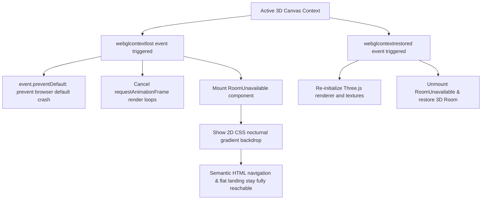

# Error Handling & Resilience Strategy

## 1. Resilience Philosophy

The portfolio follows a strict **Fail-Open & Graceful Degradation** philosophy:
> *No hardware limitation, network outage, or third-party failure should ever produce an unhandled exception, a blank screen, or block access to the candidate's core credentials.*

---

## 2. WebGL Context Loss & GPU Deprivation

WebGL applications can lose their rendering context when system GPU resources are exhausted, devices sleep, or drivers reset.



### Fallback Implementation (`src/features/room/components/RoomUnavailable.tsx`)
When WebGL is unavailable or the context cannot be restored:
- A clean, accessible fallback component is displayed informing the user of the hardware state.
- An instant button to switch directly to the **Flat Landing Portfolio** is presented.
- The CSS nocturnal wallpaper remains visible so the visual aesthetic is preserved.

### Proactive GPU Deprivation Bypass on Mobile & Touch Devices
Rather than relying on reactive context recovery after a mobile device experiences thermal throttling or Out-Of-Memory (OOM) browser crashes, the application proactively assesses device capabilities via `useResponsiveDevice`:
- On any touch-first device (`pointer: coarse`, including iPads) or screen $< 1024\text{px}$, `<RoomPreview>` is strictly not rendered in the DOM (`null`).
- This completely prevents WebGL context allocation, halts all requestAnimationFrame loops, and redirects the user directly into `FlatLanding`.

---

## 3. Sandboxed Iframe & Third-Party Embed Blocking

The Arcade cabinet includes an option to load a PS1 emulator game via an external provider (PS1FUN).

### Failure Modes & Protections
1. **`X-Frame-Options` / `frame-ancestors` Header Rejections:** Many third-party sites disallow iframe embedding.
2. **Network Timeouts & Mixed-Content Blocks:** If an embedded game fails to complete loading within **8 seconds**:
   - An accessible alert (`role="status"`) replaces the unresponsive frame.
   - A direct external link opens the destination cleanly in a new browser tab.
   - The **"Exit Game"** button resides permanently *outside* the iframe DOM, ensuring keyboard and mouse users are never trapped inside an unresponsive embed.

---

## 4. Web Audio Autoplay & Gesture Unlocking

Modern browsers (Chrome, Safari, Firefox) prohibit web applications from generating audio prior to an explicit user interaction.

### Handling Strategy (`src/features/room/audio/oiiaAudio.ts` & Arcade Synthesizers)
- All audio graphs remain completely dormant during initial page load.
- Clicking the Oiia Cat or starting an arcade game triggers `audioContext.resume()` within the verified user event loop.
- If audio initialization is denied or throws a permission error (e.g. strict enterprise policies), the error is caught silently; animations and gameplay proceed smoothly without audio.

---

## 5. Viewport Resize & Window Boundary Clamping

In the virtual monitor desktop, resizing the browser window could cause floating windows to get pushed off-screen.

### Clamping Strategy (`src/features/monitor/utils/desktopDrag.ts`)
- Window coordinates ($x, y$) and dimensions ($w, h$) are continuously bounded:
  $$x_{\text{clamped}} = \max\left(0, \min(x, W_{\text{desktop}} - w)\right)$$
  $$y_{\text{clamped}} = \max\left(H_{\text{statusbar}}, \min(y, H_{\text{desktop}} - h)\right)$$
- If the browser window shrinks, all open windows and draggable desktop icons are automatically pulled back inside the safe desktop bounds.

---

## 6. Network Resilience & Rate Limiting

### GitHub API Failover Pipeline
```text
[Fetch GitHub Events]
       │
       ├──► Success: Save to localStorage (TTL = 4 hours) ──► Render Contribution Ring
       │
       └──► Failure (Offline / HTTP 403 Rate Limit / Timeout):
                   │
                   ▼
            Read localStorage Cache
                   │
                   ├──► Cache Valid: Render Cached Stats
                   │
                   └──► Cache Empty / Expired:
                               │
                               ▼
                       Load Bundled Fallback
                 (githubContributionsFallback.json)
                               │
                               ▼
                    Render Fallback Stats
```
- No red error banners or broken widgets are ever displayed.
- The UI maintains visual completeness at all times.
