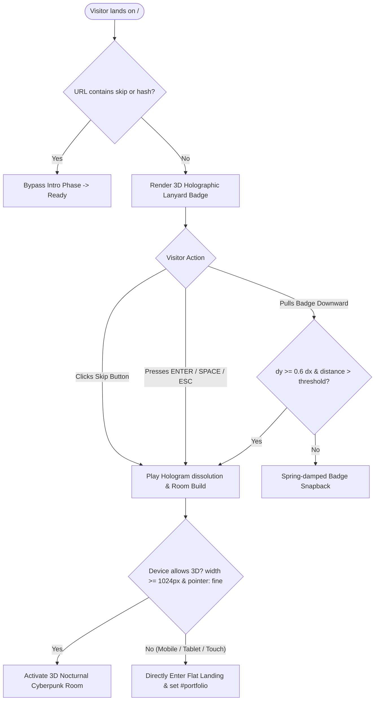
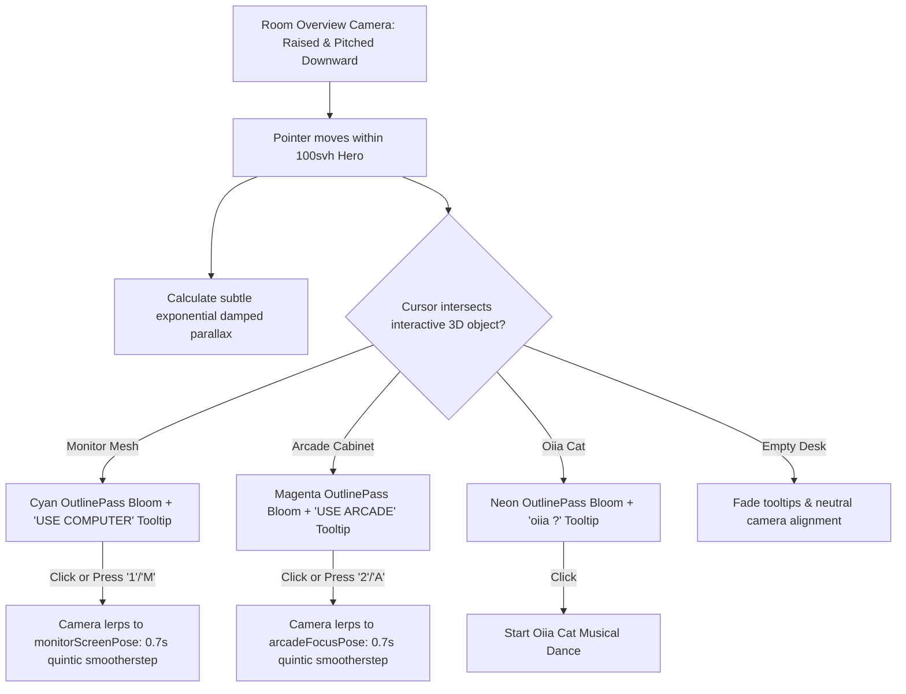
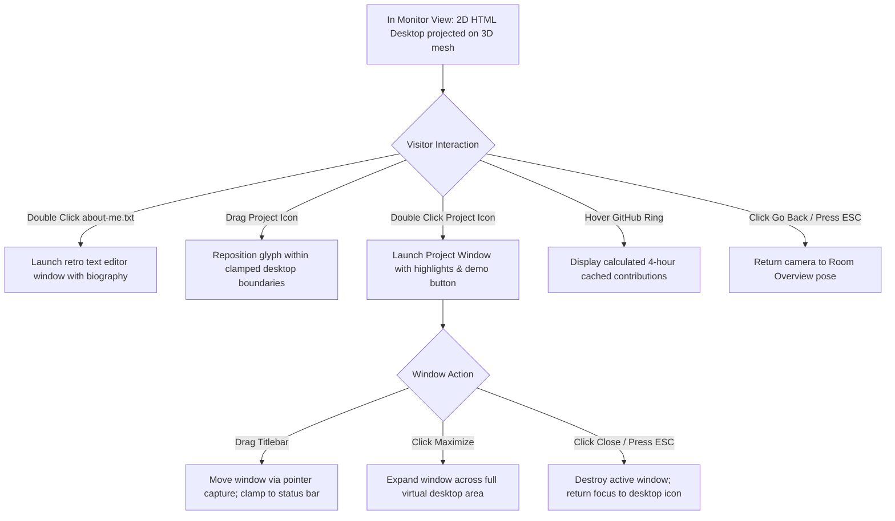
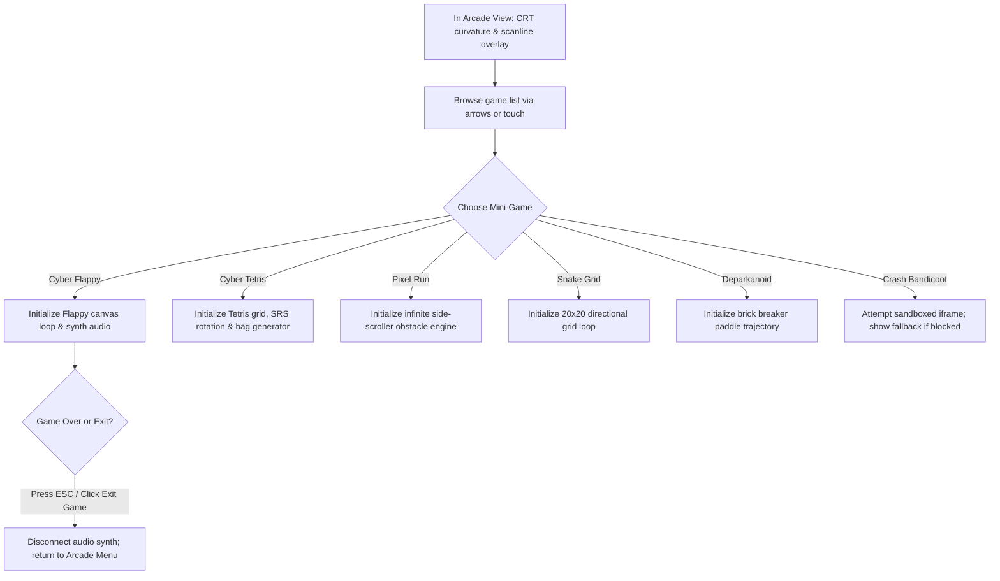
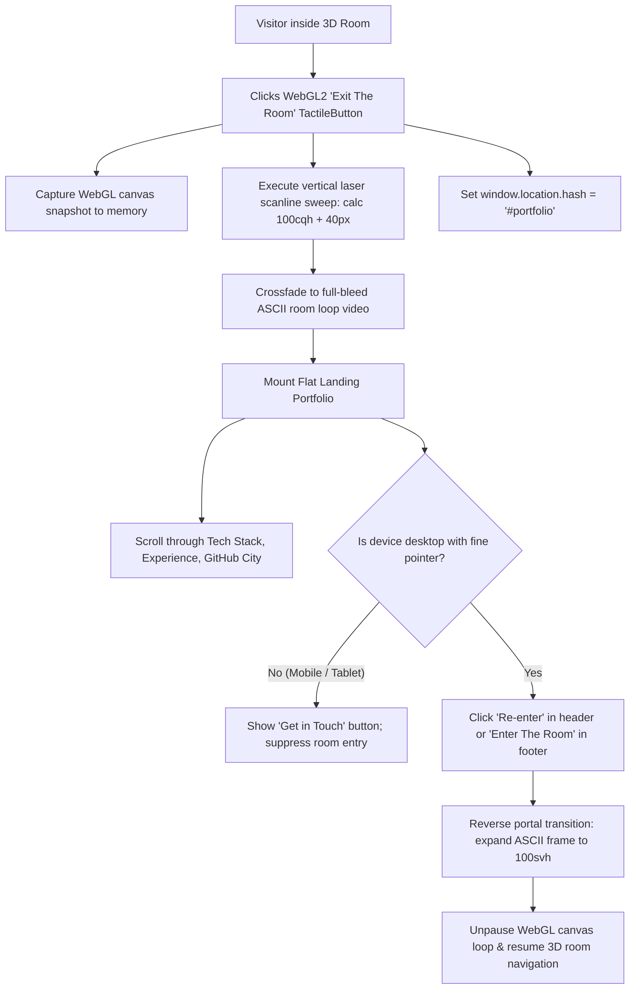

# User Experience & Interactive Flows

## 1. Overview of the Dual Experience

The application is structured around a **Dual-Mode Architecture**:
1. **The 3D Cyberpunk Room:** An exploratory 3D spatial environment centered on a developer workstation.
2. **The Flat Landing Portfolio:** A structured, high-contrast, linear presentation of experience, technical proficiencies, and open-source contributions.

Visitors transition fluidly between both worlds using tactile optical glass buttons or browser URL hashes (`#room` vs `#portfolio`).

---

## 2. Interactive Flows

### Flow 1: First Visit & Entry Lanyard Badge (`LanyardIntro`)



---

### Flow 2: 3D Room Exploration & Hotspot Navigation



---

### Flow 3: Virtual Monitor Desktop & App Workflow



---

### Flow 4: Retro Arcade Cabinet & Playable Mini-Games



---

### Flow 5: Musical Oiia Cat & Disco Drop Sync

```mermaid
sequenceDiagram
    participant User
    participant Cat as OiiaCat (3D Model)
    participant Audio as oiiaAudio (Web Audio)
    participant Room as RoomScene (Lighting)
    participant Monitor as MonitorDesktop (Virtual OS)

    User->>Cat: Clicks cat mesh in 3D room
    Cat->>Audio: play(160 BPM soundtrack)
    Cat->>Cat: Retract paws to 'loaf' mode & begin spin
    
    Note over Audio,Room: Drop Window 1 (33s–57s) & Drop Window 2 (81s–105s)
    Audio->>Room: Signal dropActive = true
    Room->>Room: Strobe ambient & point lights in neon cycles
    Audio->>Monitor: Signal dropActive = true
    Monitor->>Monitor: Hide desktop icons; activate 2x 2D dancing cat sync
    
    Note over Audio,Room: Drop Ends / Track Stops / User Navigates Away
    Cat->>Cat: Return to neutral seated pose
    Room->>Room: Restore nocturnal cyan-to-magenta ambient lighting
    Monitor->>Monitor: Restore standard virtual desktop and status bar
```

---

### Flow 6: Digital Laser Portal Transition to Flat Landing


